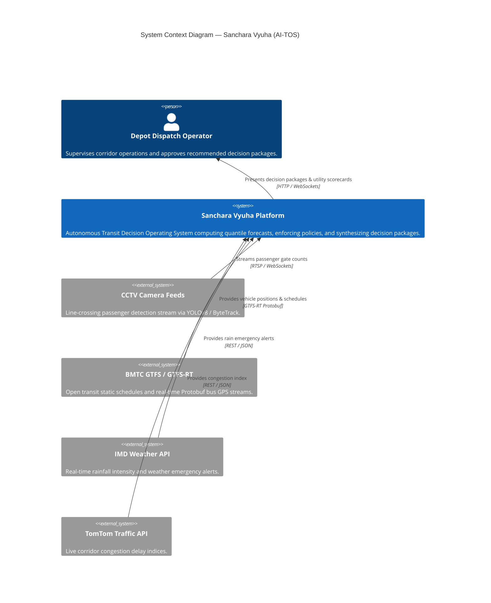
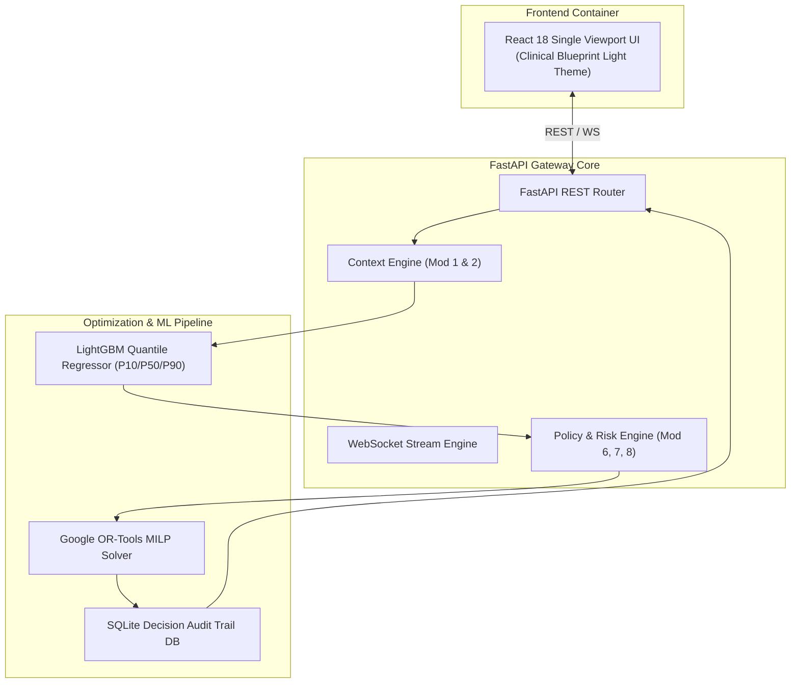
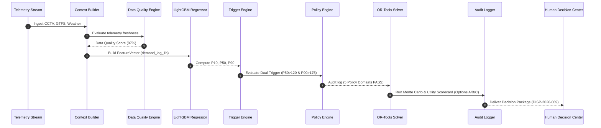

# 📖 Sanchara Vyuha — Master Architecture Book & System Design

> **Platform Version**: AI-TOS v3.1 (Autonomous Transit Decision Operating System)  
> **Standard**: C4 Model Architecture, Hard Policy Governance, Sub-50ms Latency Bounds  
> **Anchored Corridor**: BMTC Route 365J (Majestic to Electronic City, Bengaluru)  

---

## 1. System Overview & Core Principles

**Sanchara Vyuha** is an enterprise AI-Native Transit Decision Operating System built to transform raw urban telemetry into policy-governed, multi-option **Decision Packages**.

### Core Engineering Principles
1. **Deterministic Safety Path**: Zero LLM hallucinations in safety-critical dispatch decisions. Google OR-Tools enforces hard constraints (`POL-OPER-001` Driver $<8\text{h}$, `POL-FLEET-002` EV SoC $\ge 20\%$, `POL-SAFETY-003` Depot Reserve $\ge 3$).
2. **Quantile Demand Bounds**: LightGBM multi-quantile regressor computes $P10$ (conservative), $P50$ (median), and $P90$ (surge peak) bounds.
3. **Multi-Attribute Utility Scorecard**: Trade-offs between Options A, B, and C are quantified on a transparent $100$-point scorecard ($\text{Safety: }32 + \text{Wait: }28 + \text{Fuel: }15 + \text{Carbon: }10 + \text{Reliability: }15$).
4. **Open Transit Interoperability**: 100% compliant with GTFS Static and GTFS-Realtime Protobuf specifications.

---

## 2. Master System Architecture Diagram & C4 Models

### 2.1 C4 Level 1 — System Context Diagram

### 2.2 C4 Level 2 — Container Diagram

### 2.3 C4 Level 3 — Component Diagram (Decision Pipeline)

---

## 3. Architecture Decision Records (ADRs) Summary

- **ADR-001**: [Why LightGBM Multi-Quantile Regressor](file:///c:/Users/DHANUSH%20A%20G/Desktop/Sanchara-Vyuha-depo-main/Sanchara-Vyuha-depo-main/adr/001-why-lightgbm.md) over Deep Learning / LLMs.
- **ADR-002**: [Why Google OR-Tools MILP Solver](file:///c:/Users/DHANUSH%20A%20G/Desktop/Sanchara-Vyuha-depo-main/Sanchara-Vyuha-depo-main/adr/002-why-ortools.md) over Deep Reinforcement Learning.
- **ADR-003**: [Why GTFS Static & GTFS-RT Protobuf Standards](file:///c:/Users/DHANUSH%20A%20G/Desktop/Sanchara-Vyuha-depo-main/Sanchara-Vyuha-depo-main/adr/003-why-gtfs.md) over proprietary schemas.
- **ADR-004**: [Why Deterministic Hard Policy Governance](file:///c:/Users/DHANUSH%20A%20G/Desktop/Sanchara-Vyuha-depo-main/Sanchara-Vyuha-depo-main/adr/004-why-policy-engine.md) in the Decision Loop.
- **ADR-005**: [Why Dual-Trigger Condition](file:///c:/Users/DHANUSH%20A%20G/Desktop/Sanchara-Vyuha-depo-main/Sanchara-Vyuha-depo-main/adr/005-why-dual-trigger.md) ($P50 > 120 \land P90 > 175$) to eliminate false dispatches.
- **ADR-006**: [Why Multi-Attribute 100-Point Utility Scorecard](file:///c:/Users/DHANUSH%20A%20G/Desktop/Sanchara-Vyuha-depo-main/Sanchara-Vyuha-depo-main/adr/006-why-utility-score.md) for Alternative Ranking.
- **ADR-007**: [Why Monte Carlo Option Simulation](file:///c:/Users/DHANUSH%20A%20G/Desktop/Sanchara-Vyuha-depo-main/Sanchara-Vyuha-depo-main/adr/007-why-monte-carlo.md) under Uncertainty.
- **ADR-008**: [Why Embedded Decision Workspace over Generic Grafana & Prometheus](file:///c:/Users/DHANUSH%20A%20G/Desktop/Sanchara-Vyuha-depo-main/Sanchara-Vyuha-depo-main/adr/008-why-embedded-observability-over-grafana.md).

---

## 4. System Quality Attributes Summary
Refer to [docs/quality_attributes.md](file:///c:/Users/DHANUSH%20A%20G/Desktop/Sanchara-Vyuha-depo-main/Sanchara-Vyuha-depo-main/docs/quality_attributes.md) for full non-functional requirement mappings.

## 5. Requirement Traceability Matrix
Refer to [docs/traceability_matrix.md](file:///c:/Users/DHANUSH%20A%20G/Desktop/Sanchara-Vyuha-depo-main/Sanchara-Vyuha-depo-main/docs/traceability_matrix.md) for complete requirement-to-code traceability.

## 6. Operations Runbook
Refer to [docs/operations_runbook.md](file:///c:/Users/DHANUSH%20A%20G/Desktop/Sanchara-Vyuha-depo-main/Sanchara-Vyuha-depo-main/docs/operations_runbook.md) for incident response SOPs.
